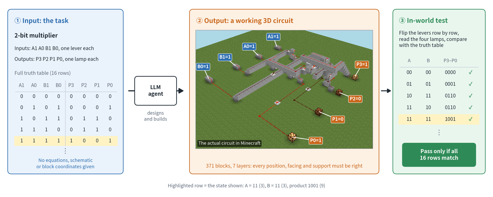
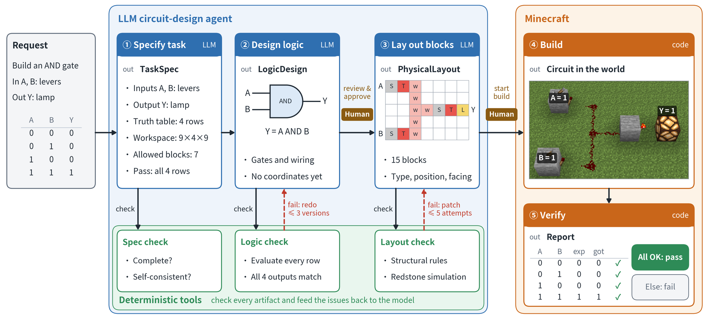
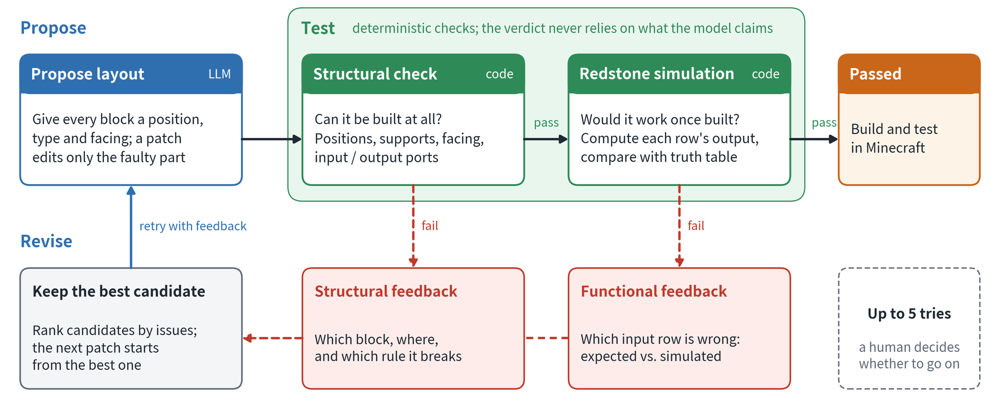

# minecraft-redstone-agent

An LLM agent that designs, builds and verifies redstone logic circuits in Minecraft.



Describe a combinational circuit in plain language. The agent turns the request into a specification, a gate-level design and a block-by-block layout, builds it on a live Minecraft server with `/setblock`, then flips the levers and reads the lamps to check every row of the truth table.

## How it works



One model does the designing. Everything that decides whether a design is right is ordinary code: schema validation, logic checking, layout validation, simulation, building and the final in-world test.

| Stage | Produced by | Checked by |
| --- | --- | --- |
| **TaskSpec**: ports, truth table, workspace, allowed blocks | LLM | Schema and semantic checks |
| **LogicDesign**: gate netlist | LLM | Evaluation against the full truth table |
| **PhysicalLayout**: position and blockstate of every block | LLM | Structural rules, then redstone simulation |
| **Build**: `/setblock` with read-back | Code | Block read-back |
| **Verify**: truth table on the live server | Code | Minecraft itself |

The layout prompt carries general knowledge about block physics and redstone idioms. It contains no fixed-coordinate gate templates and no task-specific layout compiler.

Scope: combinational logic only. No clocks, latches or history-dependent behaviour.

### The layout repair loop



A layout is first checked structurally (bounds, allowed blocks, blockstates, unique coordinates, ports, attachment supports, logic-ID mapping). If it is buildable, a steady-state redstone simulator runs it against every truth-table row. Each failure goes back to the model as a concrete diagnostic: which block, which rule, which row, what was expected and what the simulation produced.

Repairs are local patches, not rewrites. The controller ranks candidates by structural issues, then wrong output bits, then failing rows, and rolls back any patch that does not improve on the best one so far. Each round allows five attempts by default; after that a human decides whether to start another round, optionally with a hint.

The simulator is a gate, not the verdict. Only a truth table that passes on a live Minecraft server counts as success.

## Quick start

Requires Node.js 20 or later.

### Offline demo

No model and no Minecraft server needed:

```bash
npm install
npm run dev:demo
```

Open `http://localhost:5173`. This replays a built-in NOT-gate sample against an in-process mock. Every record it writes is marked `authoritative: false`, so it demonstrates the workflow and proves nothing about a circuit.

### With a real model and Minecraft

**1. Start a Minecraft server.** Use the official Java Edition 1.20.4 `server.jar` (Java 17+). Accept the EULA, then set in `server.properties`:

```properties
online-mode=false
level-type=minecraft:flat
spawn-protection=0
```

Start the server and give the bot operator rights from the server console:

```text
op RedstoneBot
```

**2. Configure the model.**

```bash
cp .env.example .env.local
```

Set `OPENROUTER_API_KEY` in `.env.local`. Requests use the OpenRouter Chat Completions API; point `OPENROUTER_BASE_URL` at any compatible service. Selectable models are an allowlist in `src/domain/model-catalog.ts`. Its entries and reference prices go stale, so review them before use.

**3. Run.**

```bash
npm run dev
```

The workbench is at `http://localhost:5173` and the API at `http://localhost:8787`. For a production build, `npm run build && npm start` serves both from port 8787.

The embedded live view depends on the optional native packages `canvas` and `prismarine-viewer`. If they fail to install, set `MC_VIEWER_ENABLED=false`; building and verification are unaffected.

## Project layout

```text
src/
├── domain/      Artifact and event schemas, block capabilities, model catalog
├── platform/    Configuration, run records, HTTP Basic Auth
├── agent/
│   ├── controller/  Session state machine, repair loop, feedback
│   ├── model/       Model adapter, prompts, format tolerance, layout map
│   ├── knowledge/   Block-physics and circuit knowledge cards for the prompt
│   └── tools/       Logic checker, layout validator, simulator, verifier
├── minecraft/   Mineflayer adapter, mock adapter, live view
├── host/        Express API and process entry point
└── web/         React workbench
```

Good places to start reading:

- `src/agent/controller/session-controller.ts`: the state machine for the whole chain.
- `src/agent/model/openrouter-adapter.ts`: per-stage prompts, retries and output validation.
- `src/agent/tools/redstone-simulator.ts`: the vanilla-rule steady-state simulator.
- `src/agent/tools/layout-validator.ts`: structural checks and the simulation gate.

## Run records

Each session is written to `runs/<session-id>/`: a manifest, an append-only `events.jsonl`, every version of every artifact, and each model request and response. Request headers are never stored, and anything shaped like a credential is redacted again on write. `runs/` is gitignored.

## Testing

```bash
npm test
npm run typecheck
```

The tests need neither a model nor Minecraft. They cover the logic checker, layout validator, simulator, model adapter and one complete non-authoritative session.

## Security

The API spends your model credit and drives your Minecraft server, and it ships with no authentication. Keep it on localhost or a trusted network. To expose it, set both `WEB_AUTH_USER` and `WEB_AUTH_PASS` to enable HTTP Basic Auth, and put it behind HTTPS.

`npm audit` reports advisories in Mineflayer's Microsoft-authentication dependencies. This project always logs in offline and never reaches that code. Do not apply the downgrade that `npm audit fix --force` suggests; it breaks protocol support.

## License

[MIT](LICENSE)
